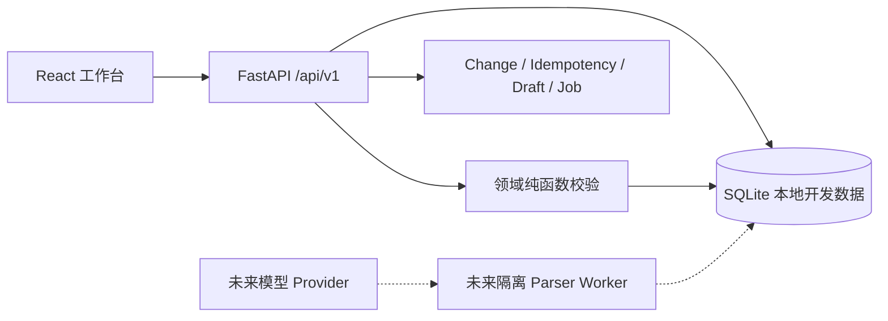

# TraceMap — 后端事务、数据完整性与安全设计 v0.3

> **工程优化说明：v0.3 / 2026-11-09**。当前仅为本地开发版 FastAPI + SQLite；并未完成生产环境认证、PostgreSQL、对象存储及隔离式 PDF Worker。参见 [算法优化](ALGORITHM_OPTIMIZATION_V0.3.md) 和 [自动化测试](VERIFICATION_V0.3.md)。

## 1. 为什么继续使用模块化单体

首个真实验证目标是数据正确性，不是部署规模。API、domain validator、持久化与前端 API 契约放在一个仓库；同步开发解析/规则演示仍只能在 loopback 开发环境使用。**任何非 `TRACEMAP_ENV=development` 环境都拒绝启动**，且即使意外监听公网地址，HTTP 中间件还会拒绝非本地回环访问（同机反向代理仍不能视为可靠防线）。不要把 Python 进程内解析当成生产异步队列。



未来正式环境保留 API/Worker 分离、PostgreSQL CAS 事务、S3 私有对象存储，并增加 Alembic 迁移。当前没有将这些规划写成“已经部署”。

## 2. 统一写入事务与防重放

写操作契约：

```http
POST /api/v1/projects/{pid}/nodes/ops
Authorization: Bearer dev-alice    # 仅开发，不能上线
If-Match: "rev-7"
Idempotency-Key: client-operation-uuid
Content-Type: application/json
```

服务层先验证身份、字段、幂等键，然后在 `Session.begin()` 中检查项目所有权、权限与当前 revision。纯领域函数生成新的 map，再调用 `UPDATE projects SET revision=expected+1 WHERE id=:id AND revision=:expected` CAS，随后写入新 Map 和 Change，最后存幂等记录并原子提交。任何校验或事务失败，都不能保存一部分节点或虚假的“成功”。

**幂等作用域**：owner + 方法/资源路径 + key；同 key + 同 payload 重放第一次结果，同 key + 不同 payload 返回 `409 IDEMPOTENCY_KEY_REUSED`。不同 key 的旧 `If-Match` 返回 `409 REVISION_CONFLICT`。旧版源上传与删除没有统一审计，现在新增同一事务内的 `source_add/source_delete` Change 记录。

`GET /api/v1/projects/{pid}/history` 返回最多 20 条**隐私最小化元数据**：`changeSetId`, `kind`, `revBefore`, `revAfter`, `createdAt`, `undone`, `undoable`。不对客户端返回 `before_json/after_json` 或原文正文。他人项目返回 404，不暴露存在性。

## 3. 不可逆来源删除与版本安全

- 添加来源：创建 Source、不可变 Paragraph、Job、revision + Change/幂等响应；重放请求不会产生第二份来源。
- 删除来源：在一个事务内降级引用状态为 `source_deleted`、撤回受影响节点的用户核验、删除 Source/Paragraph、更新 revision 并写 `source_delete` 审计事件。
- **不能**通过普通“撤销地图”恢复已删除来源：如果最新 change 是 `source_add` 或 `source_delete`，`/undo` 返回 `409 NO_UNDO_AVAILABLE`。只有 `manual`、`generation_demo`、`patch_demo` 最新 map changes 允许撤销。
- 手工修改已核验节点标题后必须将当前核验改为 `unverified`；移动到新的父节点时，对移动子树内原核验也需谨慎撤回。撤销已提交的上一步地图变更时，恢复完整节点状态并增加新 revision（不把 revision 倒退）。

**Phase 0 数据删除语义（2026-11-09）**：DELETE /sources/{sid} 是不可逆的 live-database logical purge：删除 Source/Paragraph；删除当前地图及所有历史快照中引用该来源的节点和其后代；清空并使项目内所有 Draft 失效；在同一事务内写入不含被清理文本的 source_delete 审计事件。这样可以阻止通过当前 API、导出、草稿或历史快照再次读取来源引用内容。

**仍未解决的安全擦除边界**：SQLite WAL/free pages、文件系统快照和外部备份可能保留旧字节；无引用的手工改写/释义也无法可靠归因到某个来源。该行为不是 forensic secure erase。生产上线前仍需加密对象/数据库存储、密钥销毁、备份到期和完整衍生数据血缘策略。PDF 解析现已移至带 POSIX CPU/地址空间限制和 wall-clock 超时的子进程，但它仍与 API 使用同一 OS 用户，不是独立容器/UID/seccomp 沙箱。

## 4. 领域输入硬化

校验顺序：

1. 结构类型验证：Node ID/parentId/枚举、note、sortOrder、EvidenceRef、Operation payload 必须符合值类型；`[]/{}/bool` 不应落到 dict 键查询后触发 500。
2. 资源上限：5 来源、每文件 ≤10MB、合计提取 ≤80k 码点、120 节点、5 层、每节点最多 20 个引用、每批最多 40 操作。
3. 证据边界：被引用的 Source/Paragraph 必须归属该项目，Unicode `[start,end)` 与 `exactQuote` 一致，提供的 `quoteSha256` 必须匹配；状态由服务端设置。
4. AI Patch 边界：`target` 子树白名单；移动/删除检查全部后代；人工节点及用户核验节点都不能被自动波及。
5. 故障原子性：整个批次写入预检和每步树约束校验；无效引用、环、深度超额、越界、过期 revision 均不能产生部分变更。

## 5. 接口兼容性与新增契约

| 路径 | 本轮变化 | 对已有前端 |
|---|---|---|
| `/projects/{pid}/history` | 新增只读 revision/change 元数据 | 可选接入历史视图，不影响现有 UI |
| `/projects/{pid}/sources/text` | 成功请求同时生成 `source_add` Change | 既有响应字段不变 |
| `/projects/{pid}/sources/{sid}` DELETE | `source_delete` 可追溯、撤销安全阻塞 | 既有响应字段不变 |
| `/projects/{pid}/generate` | 草稿响应新增 `selectionPolicy=lexical_v2_source_balanced` | 增量字段；保留 `generationMode=extractive_demo` |
| `/projects/{pid}/nodes/ops` | 恶意输入得到统一 422 而非潜在 500；语义更改核验自动失效 | 业务变化需说明 |
| `/projects/{pid}/export` | Markdown 清理意外换行/HTML 标签 | 保留已有导出路径；Xmind 实测仍待做 |

## 6. 实际路由与未来契约的差异管理

`packages/contracts/openapi.generated.json` 是通过 `scripts/export_openapi.py` 从 FastAPI **真实实现**导出的接口快照，包含 19 个路径模板；`--check` 进入 CI，拒绝未经同步的路径/HTTP 方法/参数和响应状态等稳定接口变化；对 FastAPI/Pydantic 版本相关的组件 Schema 不做逐字比较。产品设计阶段的 `projects/.../design/contracts/openapi.yaml` 保留为目标契约，明确不是“已实现接口”。当前未统一声明完整的响应 DTO；这仍需未来 OpenAPI schema 对照和前端客户端生成测试。

## 7. 安全威胁与阻塞项

| 威胁 | v0.3 保护 | 仍需完成 |
|---|---|---|
| IDOR / 越权访问 | owner-scoped 查询；引用查找限同项目 | 正式身份与会话吊销、多租户威胁建模 |
| 引文伪造 | 同项目段落精确校验、hash、状态不信任客户端 | 原始来源真实性检查及证据质量评测 |
| 模型越界修改 | 纯函数 Patch 作用域 + 保护后代、用户确认、CAS | 完整 LLM Patch、依赖操作 Diff、TTL |
| 损坏 JSON | 显式类型检查、统一 422、事务回滚 | 依赖漏洞扫描、广泛模糊测试 |
| 恶意 PDF | 文本层/密码/页数限制，生产模式拒绝启动 | 隔离容器、CPU/RAM/超时、对象存储和安全审查 |
| 并发丢失更新 | CAS revision、幂等持久化；SQLite 开发测试 | PostgreSQL 双会话竞争/故障注入验证 |
| 资料删除与隐私 | 源行级联清理，审计 API 不返回内容 | 完整衍生文本/快照/备份生命周期策略 |

## 8. 交付门槛

**本轮可验收**：测试使畸形输入不产生 500，移动受保护后代被拒绝，用户修改旧核验降级，引用哈希校验有效，来源变更有审计，生成检索能优先挑出非前三段中相关段落，CI 前后端无回归。

**本轮不能宣称**：真实 LLM 生成/推理精度、可靠异步 Job、隔离 PDF、生产级数据删除或 PostgreSQL 高并发性能、Xmind 导入全通过。上述门槛继续跟踪 [GitHub G1–G5 Issues](https://github.com/1998x-stack/TraceMap/issues)。
